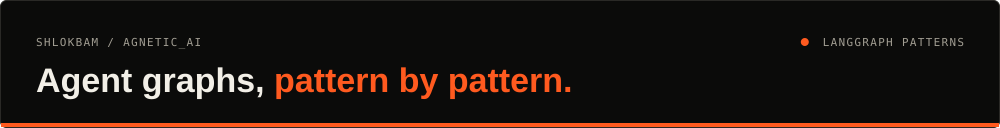
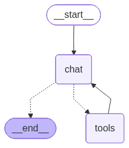
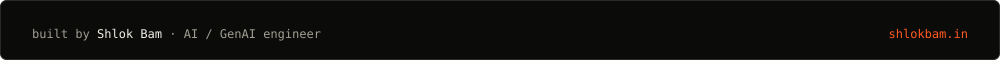

<div align="center">




<a href="#what-it-does">What it does</a> · <a href="#demo">Demo</a> · <a href="#stack">Stack</a> · <a href="#run-it">Run it</a> · <a href="https://journal-murex-three.vercel.app/journal/hands-on-agentic-ai-langgraph-sequential-parallel-conditional-workflows">Write-up</a>

</div>

One small, runnable example for each core LangGraph pattern, from a plain sequential graph to a chatbot with memory, tools and crash recovery. Written up on my journal: [Hands-On Agentic AI with LangGraph](https://journal-murex-three.vercel.app/journal/hands-on-agentic-ai-langgraph-sequential-parallel-conditional-workflows).

## What it does

| Pattern | Examples |
| :--- | :--- |
| [Sequential](Sequential%20Workflows) | A BMI calculator graph, a single LLM node, and an outline → write content chain |
| [Parallel](Parallel%20Workflows) | Batsman stats computed in parallel branches, and an essay graded on several criteria at once, then merged |
| [Conditional](Conditional%20Workflows) | A quadratic solver that routes on the discriminant, and a review classifier that routes by sentiment |
| [Iterative](%20Iterative%20Workflows) | An X-post generator that drafts, gets critiqued and rewrites until approved |
| [Chatbot](ChatBot) | A ReAct chatbot with tools and SQLite checkpoints, a Streamlit UI, state persistence and fault-tolerant resume |

## Demo

<table>
<tr>
<td></td>
<td></td>
</tr>
<tr>
<td align="center"><sub><b>Conditional routing</b></sub></td>
<td align="center"><sub><b>ReAct chatbot with tools</b></sub></td>
</tr>
</table>

## Stack

| Area | Tools |
| :--- | :--- |
| Graphs | LangGraph (state, branches, loops, checkpoints), LangChain |
| Models | Mistral (`ChatMistralAI`) |
| Tracing and UI | LangSmith, Streamlit |

## Run it

```bash
python -m venv .venv && source .venv/bin/activate
pip install -r requirements.txt
# .env: MISTRAL_API_KEY (+ LANGSMITH_API_KEY for tracing)

python "Sequential Workflows/1_bmi_workflow.py"
.venv/bin/streamlit run ChatBot/Langgraph_ChatBot/app.py    # http://localhost:8501
```

---

<div align="center">

<a href="https://shlokbam.in"></a>

<a href="https://shlokbam.in">shlokbam.in</a> · <a href="https://www.linkedin.com/in/shlokbam/">LinkedIn</a> · <a href="https://github.com/shlokbam">More projects</a>

</div>
